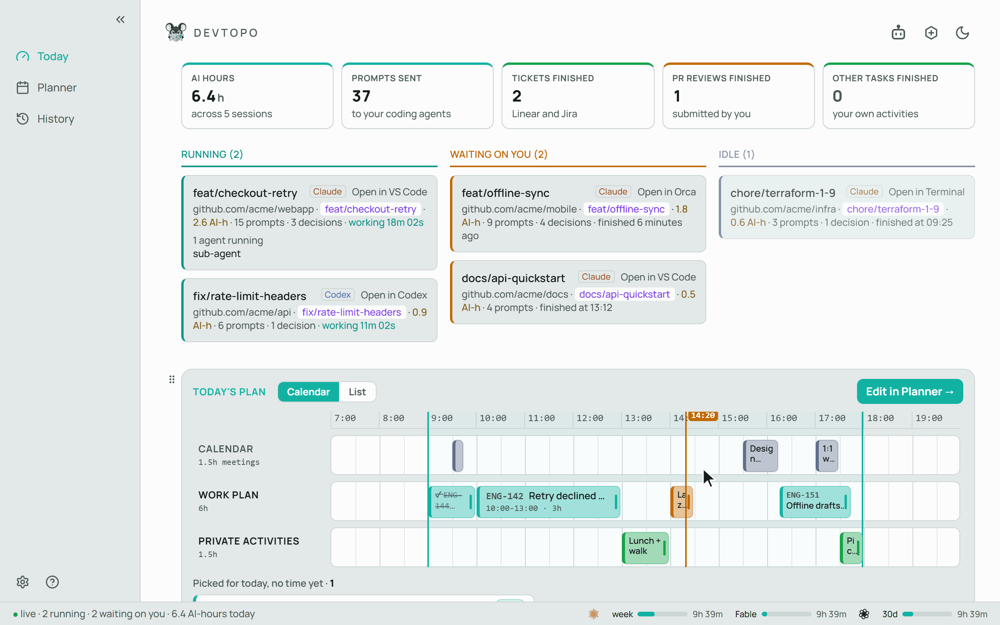
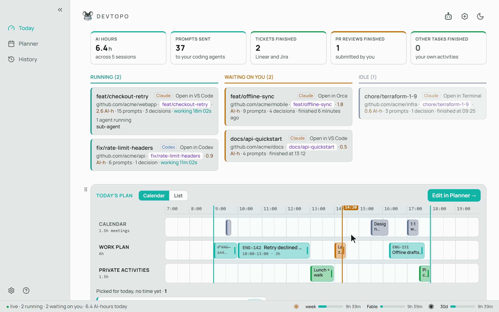
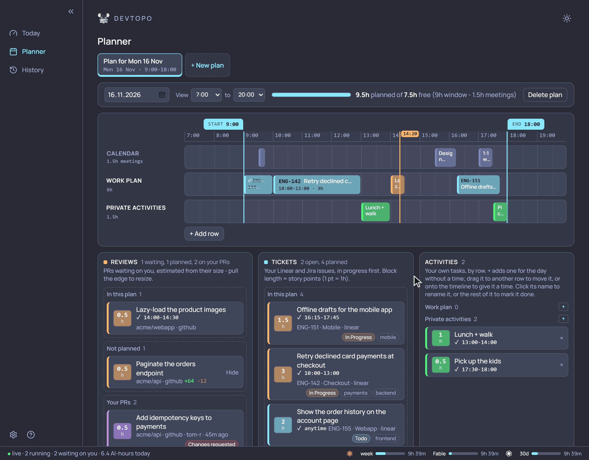
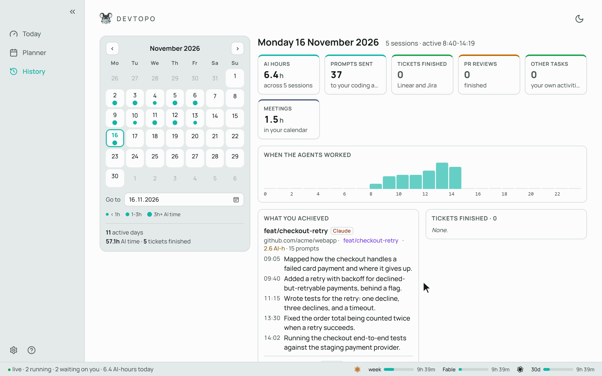
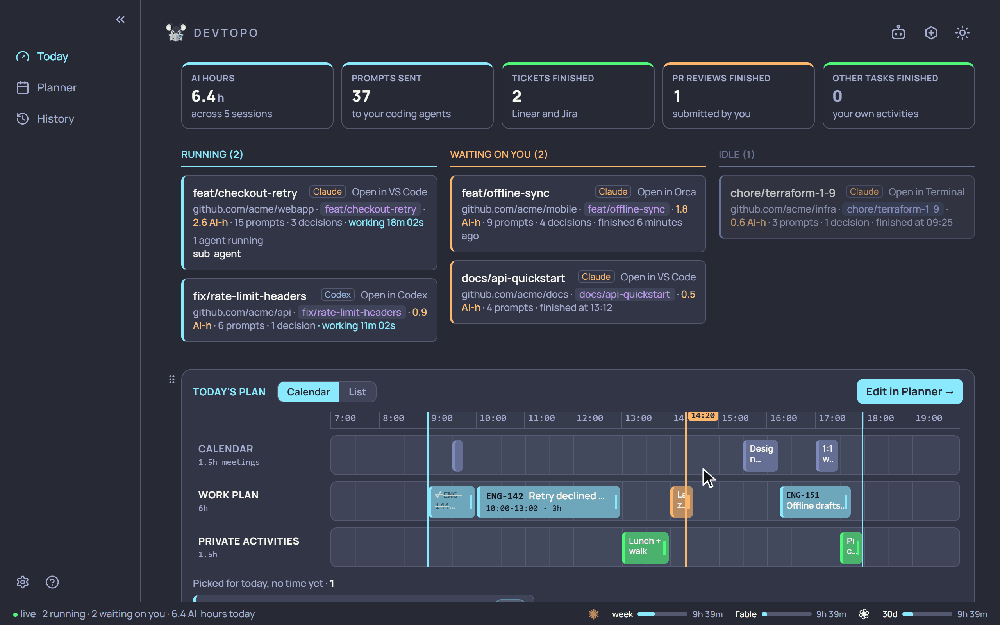

<h1 align="center">
  <br>
  DevTopo
</h1>

<p align="center">
  <b>The route map for your day with coding agents.</b><br>
  See every Claude Code and Codex session at a glance, know the moment one is waiting on you,<br>
  and plan your day around your tickets, reviews and meetings. All on your own machine.
</p>

<p align="center">
  <a href="https://github.com/devtopo-app/devtopo/releases/latest"></a>
  
  <a href="LICENSE"></a>
  
  
</p>

<p align="center">
  <a href="#install"><b>Install</b></a> ·
  <a href="#features"><b>Features</b></a> ·
  <a href="#connect-your-tools"><b>Connect your tools</b></a> ·
  <a href="#privacy"><b>Privacy</b></a> ·
  <a href="#faq"><b>FAQ</b></a> ·
  <a href="GUIDE.md"><b>Guide</b></a>
</p>

<p align="center"></p>

---

## Why DevTopo

Working with coding agents means juggling. Three sessions in three terminals, one of them
quietly waiting for your answer for twenty minutes. A review someone asked for this morning.
A ticket you meant to start. A meeting at three. And at the end of the day, little idea of
where the time went.

DevTopo puts all of it on one page, so you spend your attention on the session that needs
you, not on checking all of them.

- **Never leave an agent waiting.** Every session shows whether it is running, waiting on
  you or idle, the moment that changes, with how long its task has run.
- **Know what each session did,** in a short timed summary, written by the agent you
  already use, under your own subscription.
- **Plan a realistic day.** Your tickets, the reviews waiting on you and your meetings on
  one timeline, with the hours you actually have.
- **See where the day went.** AI hours, prompts, decisions and finished work, today and on
  any past day.
- **Keep it private.** It reads your sessions where they already are. No account, no
  server, nothing leaves your machine.

**Made for** developers who run Claude Code or Codex every day, often several sessions at
once, and want to stay on top of them without a dozen terminal tabs.

## Features

### Today: everything on one page


- **Sessions in three lanes:** running, waiting on you and idle. A session moves to
  **Waiting on you** as soon as its turn ends, and shows when it finished; a running one
  counts how long its current task has taken.
- **The day in numbers:** AI hours, prompts sent, tickets and reviews finished, and your own
  tasks done.
- **Today's plan** on a calendar or as a list, with a line for now. Click a task to mark it
  done; marking a Linear or Jira ticket done moves it there too.
- **Your PRs that got a review,** approved, commented or with changes requested, so none
  sits forgotten. Merged or closed ones drop off by themselves.
- **Finished today:** the tickets, reviews and tasks you completed.
- **Your order:** drag the sections into the order you like.

### Sessions: what each agent did



- **One card per session,** with its project, branch, AI hours, prompts and the decisions
  you made for it (the questions it asked that you answered).
- **A timed summary of the day,** one line per piece of work, refreshed as the session goes.
- **More detail** on demand: what was done, what you decided, what the agent decided on its
  own (worth a check), and what is still open.
- **Background tasks and sub-agents** still at work are shown on the card.
- **Open in** VS Code, Cursor, Orca, Windows Terminal, Terminal, iTerm, or the Claude and
  Codex apps: one click brings the session's window to the front. A session that is no
  longer running can be resumed in a new terminal.
- **Name a session** by clicking its title, when the branch name says too little.

### Planner: a day you can actually do



- **Your tickets** from Linear and Jira, coloured by status (in progress, in review, to
  do), sized from their story points.
- **Reviews waiting on you,** sized from the lines they change, from 15 minutes for a small
  one to three hours for a big one. Hide one you will not do today.
- **Your meetings** from your calendars, so you plan around them.
- **Drag cards onto the timeline,** stretch them to resize, add your own activities, and
  see at once how much you planned against the hours you have free.
- **Several plans** for one day, each with its own time window.

### History: where the time went



- **A month at a glance,** each day marked by how much the agents worked.
- **Any day in detail:** AI hours, prompts, finished tickets and reviews, meetings, when in
  the day the agents worked, and what each session achieved.

### Ask about today



- Ask in plain words: "in which session did we fix the login?", "why did we pick that
  library?".
- DevTopo answers from today's sessions and names the one each point came from, with a link
  to open it. Follow-up questions build on the answer.
- It uses the Claude Code or Codex you already have, under your own subscription. Pick the
  model; stop a question any time.

### Stickers

Small habits beside your work: a counter for glasses of water, a "done for today" for your
vitamins. Double-click to count; each one starts fresh every day.

## Works with

| Area | Supported |
| --- | --- |
| **Coding agents** | Claude Code (in a terminal, VS Code, Cursor or the Claude app) and Codex (CLI or app) |
| **Code hosts** | GitHub, GitLab (gitlab.com or your own server), Azure DevOps |
| **Issue trackers** | Linear, Jira |
| **Calendars** | Google Calendar, Outlook and Microsoft Teams, Apple Calendar, or any other with an iCal address |
| **Systems** | Windows, macOS (Apple silicon and Intel), Linux (x86-64 and ARM) |

## Install

Download the latest version from **[Releases](https://github.com/devtopo-app/devtopo/releases/latest)**.

| System | Download | Then |
| --- | --- | --- |
| **Windows** | `DevTopo.exe` | Put it somewhere it can stay and double-click it. If Windows says "Windows protected your PC", click **More info** and **Run anyway**. |
| **macOS** | `DevTopo-mac.zip` | Unzip and drag **DevTopo** to Applications. The first time, open **System Settings → Privacy & Security** and click **Open Anyway**. |
| **Linux** | `devtopo-linux-amd64.tar.gz` (or `arm64`) | `tar -xzf devtopo-linux-amd64.tar.gz && install -m 755 devtopo ~/.local/bin/` and run `devtopo`. |

DevTopo runs in the background with an icon in the tray (the menu bar on macOS) and opens
in your browser at <http://127.0.0.1:8787>. Turn on **Start at login** in the icon's menu to
have it ready every morning. It tells you when a new version is out; it never updates itself.

The [guide](GUIDE.md#install) has the details, including the tray extension GNOME needs.

## Quick start

1. **Start DevTopo.** It finds your Claude Code sessions in `~/.claude` and your Codex
   sessions in `~/.codex` by itself, today's and past ones. Nothing to set up.
2. **Get summaries.** Have [Claude Code](https://claude.com/claude-code) or the
   [Codex CLI](https://github.com/openai/codex) installed and logged in. DevTopo writes the
   summaries with it, under your subscription; no API key needed. You choose the model in
   **Settings**.
3. **Connect your tools** in **Settings**, to plan your day with your tickets, reviews and
   meetings. Each one takes a minute, with the steps shown right in its card.

## Connect your tools

| Tool | What DevTopo shows | What you need |
| --- | --- | --- |
| **GitHub** | Reviews requested of you, your own PRs once reviewed, reviews you finished | The [GitHub CLI](https://cli.github.com), logged in (`gh auth login`) |
| **GitLab** | The same, for merge requests, on gitlab.com or your own server | A personal access token with `read_api` |
| **Azure DevOps** | The same, for pull requests and votes | A personal access token with **Code (Read)** |
| **Linear** | The issues assigned to you; Mark done moves them in Linear | A personal API key |
| **Jira** | The issues assigned to you; Mark done moves them in Jira | An API token, with scopes |
| **Calendar** | Your meetings, from Google, Outlook and Teams, Apple or any other | The calendar's private iCal address |

GitHub, GitLab, Azure DevOps and calendars are only read. Linear and Jira are only changed
when you mark a ticket done, and for Jira you can leave that out. Step-by-step instructions
for each are in the [guide](GUIDE.md#connections) and in the app.

## Privacy

- **Everything stays on your machine.** DevTopo reads the session files your agents
  already write, and keeps what it derives in a local database in `~/.devtopo`. It has no
  server and no account, and collects nothing about you.
- **Not your conversations.** It stores numbers, times and the summaries, never the
  transcripts themselves.
- **Your keys stay local.** Tokens and calendar addresses are stored in that database and
  never shown again.
- **Summaries use your own agent.** They are written by the Claude Code or Codex you
  already use, with no tools that could change anything on your disk.
- **One request of its own.** Twice a day DevTopo asks GitHub whether a newer release is
  out, sending nothing about you. You can turn it off in **Settings → Updates**.

## FAQ

**Does it cost anything?**
No. DevTopo is free and open source (MIT). Summaries and Ask about today run on your own
Claude Code or Codex subscription, so they count toward its usage limits; you can pick a
small model, or turn summaries off.

**Do I need Claude Code or Codex for it to be useful?**
Yes, they are what it watches. Without one of them logged in for summaries it still shows
every session, its status and the numbers, just no written summaries.

**Does it slow my agents down or change anything in my projects?**
No. It only reads the transcript files the agents write anyway. It never writes to your
projects or your agent settings.

**Does it work with several machines?**
Each machine runs its own DevTopo and sees the sessions on that machine.

**How do I uninstall it?**
Turn off **Start at login**, quit it from the tray, delete the program, and delete
`~/.devtopo` to remove its data.

**Where do I report a bug or ask for a feature?**
Open an [issue](https://github.com/devtopo-app/devtopo/issues). The log in
`~/.devtopo/devtopo.log` often shows the cause.

## How it works

DevTopo is a single program: a Go service with a React page, built into one file per
system. It follows the transcripts Claude Code and Codex write as they work, reads the
status of each session from them, and keeps what it derives in SQLite. The page you open
in the browser is served by that program, on your own machine only, and the tray icon
keeps it running in the background.

## Build from source

You need Go 1.22 or newer and Node.js 20 or newer.

```sh
cd ui && npm ci && npm run build && cd ..
go build -o devtopo ./cmd/devtopo   # devtopo.exe on Windows
./devtopo                           # in the tray
./devtopo app                       # in the terminal, until Ctrl-C
```

More in the [guide](GUIDE.md#build-from-source).

## Contributing

Bug reports, ideas and questions are very welcome: open an
[issue](https://github.com/devtopo-app/devtopo/issues). See [CONTRIBUTING.md](CONTRIBUTING.md)
for how to help, and [SECURITY.md](SECURITY.md) to report a security problem privately.

## License

[MIT](LICENSE). Free to use, change and share.
